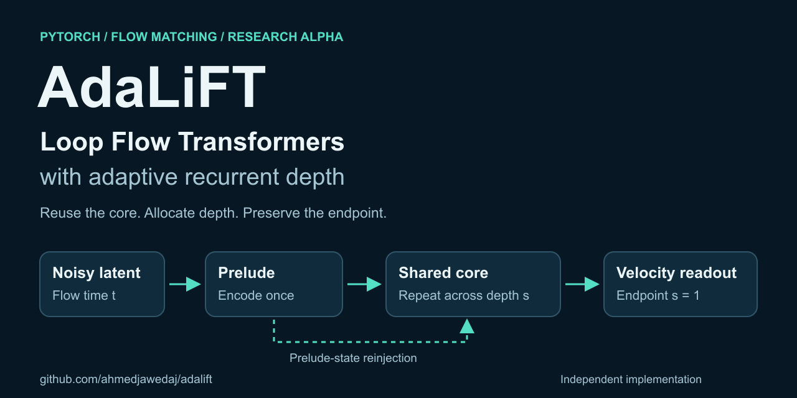
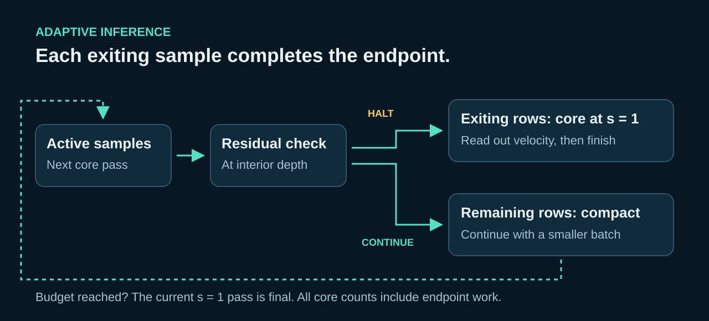

# AdaLiFT — Loop Flow Transformers with Adaptive Depth



[](pyproject.toml)
[](LICENSE)
[](docs/RELEASE_CHECKLIST.md)

**AdaLiFT is an independent PyTorch research implementation of LiFT (Loop Flow Transformers), with experimental adaptive inference for generative flow matching.** A shared transformer core runs repeatedly at each flow step. The adaptive extension lets individual samples exit early, performs a final depth-endpoint pass, and removes finished samples from subsequent recurrent batches.

Use this repository to study recurrent transformers, test-time compute, trajectory supervision, and per-sample compute allocation. It includes runnable CPU examples, synthetic smoke training, checkpoint utilities, tests, and a documented reproduction protocol.

> **Research alpha · 0.1.0rc4.** The implementation and synthetic checks are available. ImageNet/FID reproduction, pretrained checkpoints, and an adaptive quality or latency advantage are not established. GPU and distributed validation remain outstanding. See the [review handoff](docs/REVIEW_HANDOFF.md) for release evidence and limitations.

[Quick start](#quick-start) · [Examples](#examples) · [How it works](#how-it-works) · [FAQ](#faq) · [Contribute](#contribute)

## What you can explore

| Capability | Available here | Research question |
| --- | --- | --- |
| LiFT architecture | Prelude, shared recurrent core, state reinjection, depth conditioning, shared readout | How does recurrent depth affect generative modeling? |
| Flow-matching training | Sorted continuous training depths, trajectory targets, auxiliary prelude loss | How do intermediate predictions approach the endpoint target? |
| Fixed-depth inference | Choose a recurrent loop count for every sample | What changes as inference depth increases? |
| Adaptive inference | Residual halting, endpoint completion, active-row compaction | Can samples use different depths without sacrificing quality? |
| Compute accounting | Per-sample and aggregate recurrent-core evaluation counts | How much core work does a policy allocate? |
| Reproducible development | Seeded synthetic training, EMA, checkpoints, tests, CI, distribution checks | Can another researcher rerun and challenge the result? |

The model uses latent patches, RMSNorm, QK normalization, 2D rotary position embeddings, and adaLN-Zero-style conditioning. The adaptive policy is an experimental extension to the LiFT implementation; it is not a reproduced result from the paper.

## Quick start

Requires **Python 3.11 or 3.12** for the verified development matrix. The core dependencies are PyTorch and PyYAML. From a terminal on macOS or Linux:

```bash
git clone https://github.com/ahmedjawedaj/adalift.git
cd adalift
python3 -m venv .venv
source .venv/bin/activate
python -m pip install -c requirements-ci.txt -e ".[dev]"

python examples/minimal_forward.py
python examples/adaptive_depth.py
adalift-smoke --config configs/mini_lift.yaml --steps 3 --batch-size 2
```

On Windows, activate the environment with `.venv\Scripts\Activate.ps1` in PowerShell. The repository's verification targets use `make`; individual checks are listed in the [contribution guide](CONTRIBUTING.md).

The forward example prints `torch.Size([2, 4, 16, 16])`. Smoke training uses deterministic synthetic latent data: it checks the training path, rather than producing meaningful generated images. No dataset download is needed for these examples.

## Examples

### Predict a flow velocity at a fixed depth

```python
import torch

from adalift.config import ModelConfig
from adalift.models import LiFT

torch.manual_seed(42)
cfg = ModelConfig(
    in_channels=4, input_size=16, patch_size=2,
    hidden_size=128, depth=6, prelude_depth=2,
    recurrent_depth=2, num_heads=4, num_classes=10,
)
model = LiFT(cfg).eval()
x = torch.randn(2, 4, 16, 16)  # noisy latent batch
t = torch.tensor([0.25, 0.75])  # flow time, separate from recurrent depth
labels = torch.tensor([1, 2])

with torch.inference_mode():
    velocity = model(x, t, labels, num_loops=4)
print(velocity.shape)  # torch.Size([2, 4, 16, 16])
```

This returns a velocity tensor in latent space. Image generation additionally requires trained weights, a data pipeline, and a latent decoder.

### Allocate recurrent depth per sample

Using the model and inputs above:

```python
with torch.inference_mode():
    result = model.forward_adaptive(
        x, t, labels,
        max_loops=8, min_loops=2, residual_threshold=0.01,
    )

print(result.prediction.shape)
print(result.loops_used.tolist())  # actual core evaluations per sample
print(result.total_core_evaluations)
print(result.mean_loops)
```

Every returned prediction includes a final recurrent-core evaluation at depth `s=1`. `max_loops` caps actual evaluations, including that endpoint pass. `min_loops` is the earliest intermediate residual check, so an exit at that check normally costs `min_loops + 1` evaluations. Reaching the budget already supplies the endpoint, with no extra pass.

**Counts describe recurrent-core work only.** They exclude the prelude, prediction heads, and batching overhead, and do not establish FLOP or wall-clock savings. The untrained model starts with a zero prediction head; its early exits demonstrate bookkeeping, not useful adaptive behavior.

Run [the complete adaptive example](examples/adaptive_depth.py) to inspect counts and compare fixed-depth sampling against adaptive sampling with halting disabled, using identical initial noise.

### Backpropagate a trajectory loss

Using `model`, `x`, and `labels` from the first example:

```python
from adalift.flow import lift_trajectory_loss

model.train()
output = lift_trajectory_loss(
    model, x, labels, k_train=2,
    generator=torch.Generator().manual_seed(42),
)
output.loss.backward()
print(float(output.loss.detach()))
```

For real training, `x` is replaced with data latents. The loss interpolates from a stop-gradient prelude prediction to the flow target across sampled depth coordinates. The [architecture notes](docs/ARCHITECTURE.md) explain the objective, residual normalization, and sampler behavior.

## How it works

LiFT separates **flow time `t`** from **recurrent depth `s`**. The prelude encodes a noisy latent. A shared transformer core then refines its state repeatedly, conditioned on depth and with prelude-state reinjection. Increasing the loop count reuses the same core parameters.



An intermediate prediction at `s < 1` is supervised as a point on the trajectory toward the flow target. AdaLiFT therefore gives an early-exiting sample a final core pass at `s=1` before returning its velocity. Finished rows are removed from later recurrent batches. This preserves endpoint semantics; its effect on generated sample quality still needs measurement.

For comparisons, both Euler samplers accept `initial_noise`. They temporarily select evaluation mode and restore the caller's module modes. See [sampling APIs](src/adalift/flow/sampling.py) and [adaptive architecture details](docs/ARCHITECTURE.md).

## Research status and roadmap

The [B/2-R2 candidate config](configs/lift_b2_r2_candidate.yaml) records architecture and optimizer fields from the LiFT paper, including width, heads, prelude/core depth, `K_train=4`, AdamW, EMA, warmup, and clipping. It does **not** encode the full batch size, update count, dataset, or precision protocol. The smoke runner uses synthetic FP32 data.

| Stage | Goal |
| --- | --- |
| Implementation correctness | Unit tests and toy convergence checks |
| Mini-LiFT diagnostic | Examine inference depths 4, 8, and 16; tiny-model extrapolation is diagnostic |
| Faithful reproduction | Latent ImageNet subset, then ImageNet-256 with the recorded protocol |
| Adaptive-depth evaluation | Compare halting policies at matched compute and measured quality |
| Compute allocation | Study flow steps versus recurrent depth |
| Research release | Publish reproducibility artifacts, checkpoints, metric results, and a report |

See the [roadmap](docs/ROADMAP.md), [experiment protocol](docs/EXPERIMENTS.md), and [reproducibility standard](docs/REPRODUCIBILITY.md). A plausible loss curve alone is insufficient evidence of reproduction.

## FAQ

### What is AdaLiFT?

AdaLiFT is a PyTorch research codebase for Loop Flow Transformers and experimental adaptive recurrent-depth inference in flow-matching generative models.

### Is this the official LiFT implementation?

No. This is an independent implementation based on the [LiFT paper](https://arxiv.org/abs/2610.05538) and public descriptions, with its own adaptive extension. See [acknowledgements and provenance](docs/ACKNOWLEDGEMENTS.md).

### Is it a diffusion transformer or a flow-matching model?

It uses DiT-style transformer components to predict flow velocities. Its training objective and Euler sampler implement flow matching, with additional supervision along recurrent depth.

### Can I try it without a GPU?

Yes. The small forward, adaptive-depth, and synthetic training examples run on CPU. CPU examples do not establish feasibility or performance for full-scale ImageNet training.

### Are pretrained models or reproduced ImageNet results available?

No. This release candidate provides implementation and synthetic validation. It does not ship pretrained checkpoints or claim a reproduced ImageNet/FID result.

### Does adaptive depth make inference faster?

The implementation skips later core evaluations for finished samples. Whether that improves latency at acceptable quality depends on trained weights, hardware, batch sizes, and halting policy; that comparison remains an open experiment.

## Contribute

Useful contributions include clearer tutorials, regression tests, independent paper-to-code checks, and reproducible quality/compute experiments. Start with [CONTRIBUTING.md](CONTRIBUTING.md), then browse [issues](https://github.com/ahmedjawedaj/adalift/issues) or [propose a focused improvement](https://github.com/ahmedjawedaj/adalift/issues/new/choose).

- **New to the project?** Run the CPU examples and improve a confusing explanation or error report.
- **Research contributor?** Pick a roadmap question, state a hypothesis, and record a falsifiable comparison protocol before running an experiment.
- **Independent reviewer?** Use the [review handoff](docs/REVIEW_HANDOFF.md) and report exact files, lines, and reproduction steps.

If this work is useful, a star helps others find it. Sharing a reproducible result or a concrete issue is equally welcome.

## Documentation and development

| Resource | Purpose |
| --- | --- |
| [Architecture](docs/ARCHITECTURE.md) | Components, depth semantics, objective, and compute accounting |
| [Paper breakdown](docs/PAPER_BREAKDOWN.md) | Paper-to-implementation mapping and protocol distinctions |
| [Reproducibility](docs/REPRODUCIBILITY.md) | Required evidence for research claims |
| [Release checklist](docs/RELEASE_CHECKLIST.md) | Remaining publication gates |
| [Security policy](SECURITY.md) | Reporting vulnerabilities |
| [Governance](GOVERNANCE.md) and [code of conduct](CODE_OF_CONDUCT.md) | Community expectations |
| [Maintainer guide](docs/MAINTAINER_GUIDE.md) | Review rules, branch protection, fork CI, and releases |

```text
src/adalift/
  models/       transformer blocks, embeddings, recurrent LiFT core
  flow/         trajectory loss and Euler samplers
  adaptive/     residual-halting policy
  training/     EMA, checkpoints, synthetic smoke runner
  data/         deterministic research datasets
  evaluation/   metric and profiling helpers
examples/       small runnable entry points
configs/        mini model and paper-derived candidate configuration
```

Run `make verify` for skill synchronization, lint, formatting, type checks, and tests with coverage. Run `python scripts/verify_distribution.py` to validate built distributions. Codex and Claude Code workflows are documented in [AGENTS.md](AGENTS.md) and [CLAUDE.md](CLAUDE.md); canonical skills live under `.agents/skills/`.

## Citation and license

Credit the original method via the [LiFT paper](https://arxiv.org/abs/2610.05538). To cite this implementation, use the repository's [CITATION.cff](CITATION.cff) and record the exact commit or release used in your experiment.

AdaLiFT is licensed under [Apache-2.0](LICENSE).
